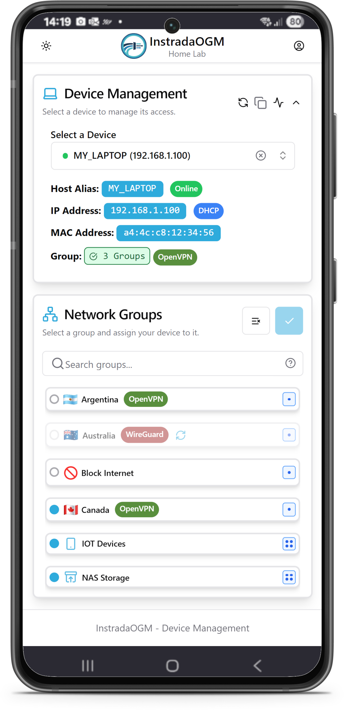
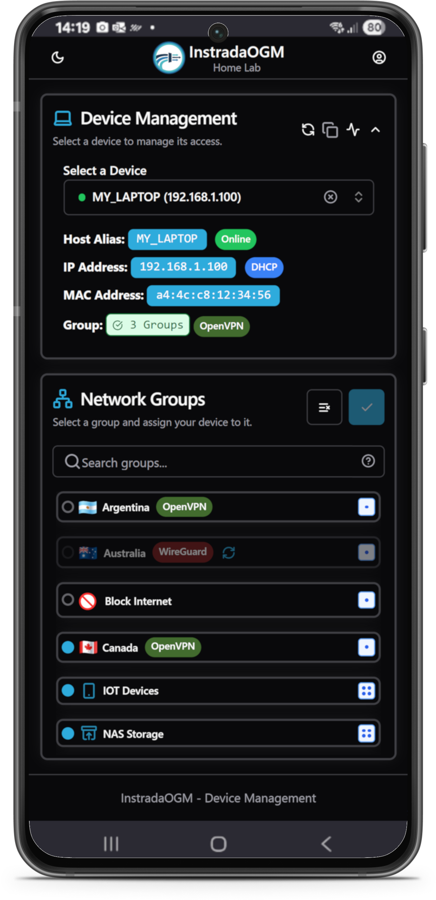
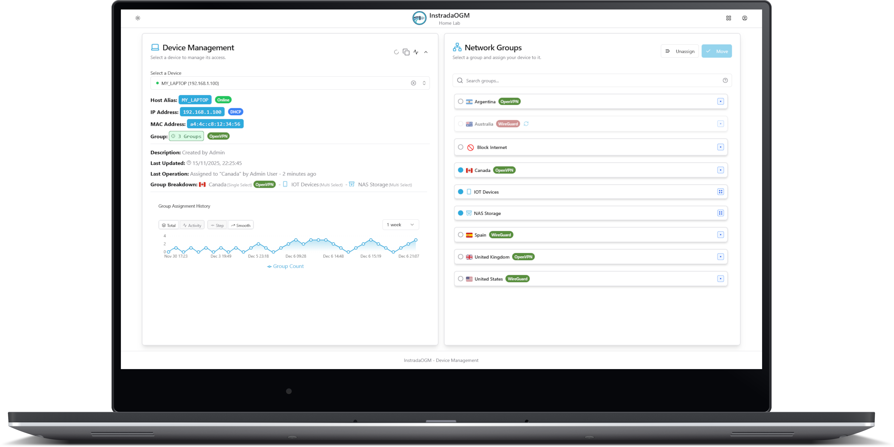
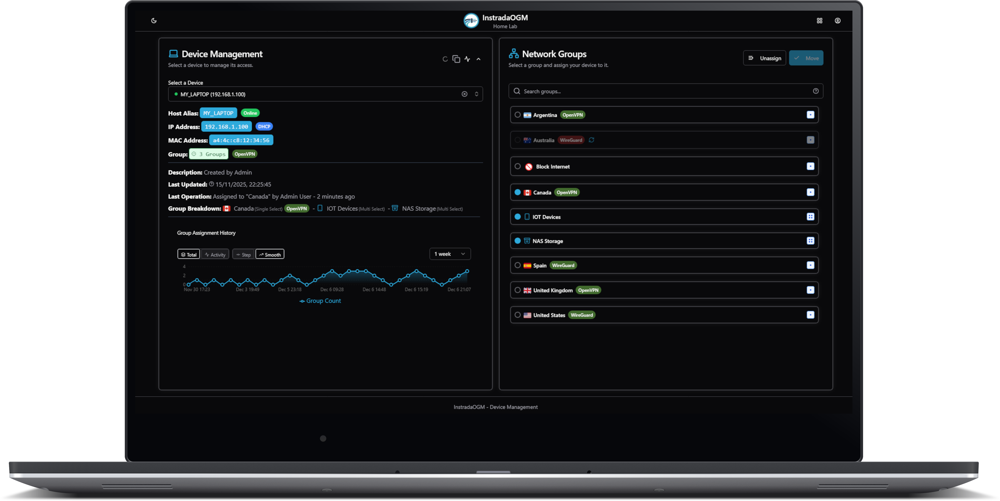
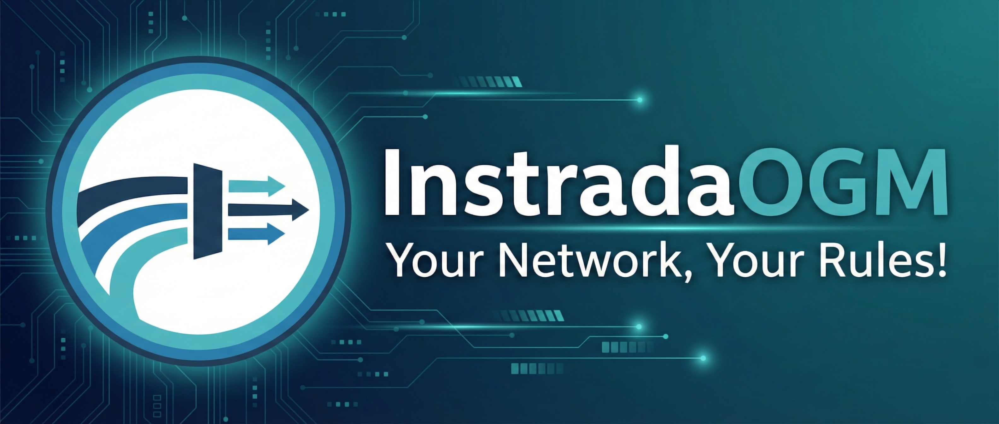

<div align="center">
  
  <h1>InstradaOGM</h1>
  <p><em>"Open Group Manager" for OPNsense Firewalls</em></p>
</div>

<div align="center">
  <h3><a href="#quick-start">🚀 Jump to Quick Start Guide</a></h3>

[](https://opnsense.org)
[](https://hub.docker.com)
[](https://nextjs.org)
[](https://openid.net/connect/)
[](LICENSE)
</div>

## 📄 Disclaimer

InstradaOGM is a third-party tool and is **not affiliated with, endorsed by, or connected to [Deciso B.V.](https://deciso.com/)** (the company behind [OPNsense](https://opnsense.org/)). OPNsense is a registered trademark of Deciso B.V.

<h2>🚀 What is InstradaOGM?</h2>

**Instrada(OGM)** is a modern, web-based application that transforms how you manage network access control on OPNsense firewalls. Instead of manually configuring firewall rules, simply add or remove devices from predefined network groups to instantly control their Internet access, VPN routing, and network policies.

### ✨ Key Benefits
- **🎯 One-Click Network Control**: Instantly change device network access without touching firewall rules
- **🌐 VPN-Free Routing**: Route devices through different VPNs without installing VPN clients on each device
- **📱 Self-Service Portal**: Users can manage their own device access from any browser
- **🔄 Real-Time Changes**: Network policy changes take effect immediately
- **🛡️ Security First**: Role-based access control with comprehensive audit logging

---

## 📱💻 Screenshots

<div align="center">

### 📱 Mobile Interface
</br>



### 💻 Desktop Interface
</br>



</div>

---

## 📱 Install as PWA

InstradaOGM is a Progressive Web App (HTTPS required). Android Chrome: menu → Add to Home screen. iOS Safari: Share → Add to Home Screen. Desktop Chrome/Edge: install icon in the address bar.

---

## 🌟 Core Features

- **🏠 Self-service portal** — Auto-detects the current device for one-click group join/move/leave. Can be turned off entirely: [Global Self-Service Disable](docs/FEATURES/GLOBAL_SELF_SERVICE_DISABLE.md)
- **💻 Multi-device management** — Bulk operations, search, conflict detection, and assignment history for authorized devices
- **🔧 Admin control** — Network groups, host aliases, DHCP, users (USER / ADMIN / SUPER_ADMIN), [SSO](docs/CONFIGURATION/SSO_PROVIDER_CONFIG.md), [audit logging](docs/api/api_docs/25_audit_log_management_endpoints.md), and [update checks](docs/api/api_docs/31_update_endpoints.md)
- **🌐 Network aliases** — CIDR-based OPNsense aliases with group assignment ([guide](docs/FEATURES/NETWORK_ALIAS_MANAGEMENT.md))
- **⏰ Scheduled assignments** — Weekly, once, or cron-based ASSIGN / UNASSIGN / CLEAR_ALL ([guide](docs/FEATURES/SCHEDULED_ASSIGNMENTS.md), [API](docs/api/api_docs/32_schedule_endpoints.md))
- **🔍 MAC address tracking** — ARP discovery, privacy-MAC detection, exclusions, vendor lookup ([guide](docs/FEATURES/MAC_ADDRESS_TRACKING.md))
- **🎯 SingleSelect / MultiSelect groups** — Mutually exclusive vs additive membership ([guide](docs/FEATURES/SINGLE_SELECT_MULTI_SELECT_FEATURE.md))
- **🏷️ Smart device renaming** — Rename host aliases with DHCP reservation offers and MAC randomization warnings ([DHCP](docs/CONFIGURATION/DHCP_RESERVATIONS.md), [MAC randomization](docs/FEATURES/MAC_RANDOMIZATION_GUIDE.md))
- **🔐 Auth & 2FA** — Local accounts with TOTP + backup codes, plus Authentik / Entra ID / Keycloak OIDC ([2FA guide](docs/FEATURES/TWO_FACTOR_AUTHENTICATION_GUIDE.md))
- **📊 Analytics & monitoring** — API usage, realtime activity, performance, and account dashboards ([overview](docs/TROUBLESHOOTING/ANALYTICS_OVERVIEW.md), [activity dashboard](docs/FEATURES/ACCOUNT_ACTIVITY_DASHBOARD.md))
- **💾 Encrypted backup & restore** — AES-encrypted backups and the backup manager script ([guide](docs/FEATURES/BACKUP_MANAGEMENT.md))
- **👥 Unmanaged groups** — Groups InstradaOGM can see but not modify ([guide](docs/FEATURES/UNMANAGED_GROUPS_FEATURE.md))

---

## 🔧 How It Works

InstradaOGM uses OPNsense network groups through a web UI. You create the firewall rules in OPNsense and attach them to groups; InstradaOGM manages group membership, not the rules themselves.

#### Traditional Approach ❌
```
Device needs VPN access → Edit firewall rules → Apply configuration → Test → Repeat for each device
```

#### InstradaOGM Approach ✅
```
Device needs VPN access → Click "Join VPN Group" → Done! (Instant network policy change)
```

> [!NOTE]
> Overall network security depends on your OPNsense rules, hardware, and design. InstradaOGM is the management layer.

### 🔄 Core Integration Points

1. **OPNsense Host Aliases** — Devices as IP + friendly name, with ARP hostname detection and live sync
2. **Network Groups** — Existing OPNsense groups drive policy; friendly names, icons, and membership are managed here
3. **VPN Integration** — Monitor OpenVPN, WireGuard, and IPsec; map groups to VPN connections so devices route without a client
4. **Policy Enforcement** — Membership changes apply immediately via the OPNsense API; your existing firewall rules determine access

### 🛠️ Tech Stack

- **Frontend**: Next.js 16, React 18, TypeScript, Tailwind CSS, Radix UI
- **Backend**: Next.js API routes, Prisma ORM
- **Database**: SQLite or PostgreSQL
- **Auth**: NextAuth.js — local accounts with 2FA, plus Authentik / Microsoft Entra ID / Keycloak OIDC
- **Deploy**: Docker (SQLite and PostgreSQL images)

---

## 🌐 Reverse Proxy Setup (Required)

Production deployments need a reverse proxy for HTTPS/SSL termination, client IP forwarding, and HTTP→HTTPS redirects. **Traefik is recommended.**

- **[Traefik](docs/CONFIGURATION/TRAEFIK-PROXY-SETTINGS.md)** (recommended) — automatic HTTPS, Docker discovery; templates in [`traefik/`](traefik/)
- **[NGINX](docs/CONFIGURATION/NGINX-PROXY-SETTINGS.md)** — traditional reverse proxy (or Nginx Proxy Manager)
- **[Caddy](docs/CONFIGURATION/CADDY-PROXY-SETTINGS.md)** — automatic HTTPS (guide not tested)

---

<div id="quick-start"></div>
## 🚀 Quick Start

### ⚡ Option 1: One-Line Install Script (Fastest — Linux/WSL Only)

SQLite install for testing and home labs. Linux (Debian/Ubuntu/RHEL-based) or Windows WSL, with sudo and internet access.

```bash
sudo bash -c "$(curl -fsSL https://raw.githubusercontent.com/rdeangel/InstradaOGM/refs/heads/main/scripts/install-instradaogm.sh)"
```

What it does:
- Installs dependencies (Node.js v24, SQLite, etc.)
- Downloads the latest release (or uses `--package` for a local `.tar.gz`)
- Sets up a systemd service and walks through OPNsense API configuration
- Starts InstradaOGM at `http://YOUR_SERVER_IP:3000`

```bash
# Install latest version
sudo ./install-instradaogm.sh --latest

# Install from a local package archive (.tar.gz) instead of downloading from GitHub
sudo ./install-instradaogm.sh --package /path/to/instradaogm-sqlite-vX.Y.Z-amd64.tar.gz
# Alias: --local-package   (or set PACKAGE_PATH)

# Update / repair / uninstall
sudo ./install-instradaogm.sh --update
sudo ./install-instradaogm.sh --reinstall
sudo ./install-instradaogm.sh --uninstall
sudo ./install-instradaogm.sh --clean-backups
sudo ./install-instradaogm.sh --help
```

For multi-user production, use Docker with PostgreSQL below.

### 🐳 Option 2: Docker Deployment (Recommended for Production)

- **[SQLite](docs/DEPLOYMENT/DOCKER_DEPLOYMENT_SQLITE.md)** — home labs and small deployments (< 10 users)
- **[PostgreSQL](docs/DEPLOYMENT/DOCKER_DEPLOYMENT_POSTGRES.md)** — production and concurrent use
- **[Deployment overview](docs/DEPLOYMENT/README.md)** — which option to pick

Both Docker guides cover HTTP (local/home lab) and HTTPS (Traefik) deployments.

### 📋 Prerequisites (All Methods)

- **OPNsense**: 23.1+ (preferred v25.1+) with API access
- **API credentials**: System > Access > Users > API Keys. Required page privileges: [Installation Guide](docs/SETUP/INSTALLATION_GUIDE.md#required-opnsense-api-permissions)
- **Network access** from the app to the firewall
- **Pre-configured** OPNsense network groups and firewall rules

## 🔧 Development

```bash
npm install
npm run setup-dirs
npm run prisma:generate
npm run dev
npm run lint                 # eslint .
npm run type-check:pretty    # tsc --noEmit --pretty
```

Custom Docker builds, multi-platform images, volume layout, and production `npm run build` / `npm start`: **[CONTRIBUTING.md](CONTRIBUTING.md)**. Setup detail: [Installation Guide](docs/SETUP/INSTALLATION_GUIDE.md), [Environment Setup](docs/SETUP/ENVIRONMENT_SETUP_GUIDE.md).

---

## 🔌 API

REST API with 100+ endpoints, USER / ADMIN / SUPER_ADMIN roles, and session, API-key, or Bearer auth. Full reference: **[API Index](docs/api/api_docs/API_Index.md)**.

```bash
curl -X POST "https://your-instrada-ogm.com/api/opnsense/host-group-management" \
  -H "Authorization: Bearer ${API_KEY}" \
  -H "Content-Type: application/json" \
  -d '{"operation":"assign","ipAddress":"192.168.1.100","groupFriendlyName":"VPN Users"}'
```

---

## 📚 Documentation Index

- **[Documentation Center](docs/DOCUMENTATION_INDEX.md)** — full hub
- [Features](docs/FEATURES/FEATURES_INDEX.md) · [Setup](docs/SETUP/SETUP_INDEX.md) · [Configuration](docs/CONFIGURATION/CONFIGURATION_INDEX.md)
- [Deployment](docs/DEPLOYMENT/README.md) · [API](docs/api/api_docs/API_Index.md) · [Troubleshooting](docs/TROUBLESHOOTING/TROUBLESHOOTING_INDEX.md)

---

## 📞 Support & Community

### 🆘 Getting Help
- **Installation**: [Setup & Installation](docs/SETUP/INSTALLATION_GUIDE.md)
- **Documentation**: [Documentation Center](docs/DOCUMENTATION_INDEX.md)
- **API**: [API Index](docs/api/api_docs/API_Index.md)
- **Discussions**: GitHub Discussions
- **Issues**: GitHub Issues for bugs and feature requests

### 🔒 Security
Report security vulnerabilities through GitHub's security advisory system. We take security seriously and will respond as soon as possible.

---

## 🙏 Acknowledgments

### MAC Vendor Database

InstradaOGM uses the **[MACLookup.app](https://maclookup.app)** MAC vendor database as a fallback source for device vendor identification. When OPNsense doesn't have vendor information for a particular MAC address, InstradaOGM queries a locally stored copy of the MACLookup database (downloaded from their JSON database export).

**Database Details:**
- **Source**: [MACLookup.app Downloads](https://maclookup.app/downloads/json-database)
- **Coverage**: 37,000+ MAC address prefixes (OUI database)
- **Block Types**: Supports MA-L, MA-M, MA-S, IAB, and CID assignments
- **Usage**: Local file lookup only (no API calls)
- **Terms**: [MACLookup Terms and Conditions](https://maclookup.app/terms-and-conditions)

This database is used exclusively as a fallback when OPNsense ARP table queries don't return vendor information, ensuring comprehensive device identification across your network.

---

## 📄 License

This project is licensed under the **MIT License** - see the [LICENSE](LICENSE) file for details.

---

<div align="center">
  
  <h3>🎉 Built with ❤️ for the OPNsense Community</h3>
  <p>
    <strong>Star ⭐ this repo if InstadaOGM helps you manage your network!</strong>
  </p>
  <p>
    <a href="https://github.com/rdeangel/InstradaOGM/stargazers">⭐ Star</a> •
    <a href="https://github.com/rdeangel/InstradaOGM/issues">🐛 Issues</a> •
    <a href="https://github.com/rdeangel/InstradaOGM/discussions">💬 Discussions</a> •
    <a href="docs/api/api_docs/API_Index.md">📚 API Docs</a>
  </p>
</div>
